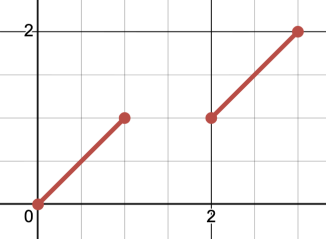

# Homeomorphisms vs Quotient Maps vs Open Maps

**Recall:** a function $f:X\rightarrow Y$ is continuous when $U$ open in $Y$ implies $f^{-1}(U)$ is open in $X$.

Let $f:X\rightarrow Y$ be a function. $f$ is an _open map_ if for all $U$ open in $X$, $f(U)$ is open in $Y$. $f$ is a _quotient map_ if $V$ is open in $Y$ if and only if $f^{-1}(V)$ is open in $X$. $f$ is a homeomorphism if both $f$ and $f^{-1}$ are continuous. Finally, a subset $C$ of $X$ is _saturated_ if it equals the complete inverse of a set in $Y$, i.e. $\exists D$ such that $f^{-1}(D)=C$.
> An alternative definition of quotient maps is that they send saturated open sets in $X$ to open sets in $Y$.

## All Homeomorphisms are Quotient Maps.

Let $f:X\rightarrow Y$ be a homeomorphism. Because $f$ and $f^{-1}$ exist, $f$ is a surjective map (because $f$ is bijective). Let $V$ be an open set in $Y$, and clearly $f^{-1}(V)$ is open in $X$ since $f$ as a homeomorphism is continuous. Now let $S$ be a set in $Y$ such that $f^{-1}(S)$ is open in $X$. Because $f$ is bijective, $f=(f^{-1})^{-1}$, therefore $(f^{-1})^{-1}[f^{-1}(S)]=S$ which is open in $Y$ because $f^{-1}$ is continuous. Therefore a set $U$ is open in $Y$ if and only if $f^{-1}(U)$ is open, meaning $f$ is a quotient map. ☑

## Not all Quotient Maps are Homeomorphisms.

Let $f:[0,2\pi)\rightarrow S^1$ via $x\mapsto (\cos(t),\sin(t))$, which we visualize with a diagram of the unit circle. Consider the interval from the point $\left(\frac{\sqrt{2}}{2},-\frac{\sqrt{2}}{2}\right)$ to $\left(\frac{\sqrt{2}}{2},\frac{\sqrt{2}}{2}\right)$ such that it includes $0$: the preimage of this interval is $\left[0,\frac{\pi}{4}\right)\cup\left(\frac{7\pi}{4}, 2\pi\right)$ which is open in the subspace topology. However $f$ is not a homeomorphism because the set $\left[0,\frac{\pi}{4}\right)$ is open, yet $f$ sends that interval to an interval that is not open on the unit circle.

## Not all Quotient Maps are Open Maps.

Trivially, all open maps are quotient maps because if every open set maps to an open set, then every saturated open set maps to an open set. However consider the following map $p:X\rightarrow Y$ where $X = [0,1]\cup[2,3]$ and $Y=[0,2]$ are both subspaces of ℝ using the standard topology. $p$ is a quotient map, however $p$ is not an open map because the image of $[0,1]\subseteq X$ is $[0,1]\cup⟨2⟩$ which is not open, even though $[0,1]=(-0.5,1.5)\cap X$ is open in the subspace topology. 

# Example Questions
1. Prove that all homeomorphisms are open maps without invoking quotient maps.
2. Consult the above diagram. Prove that for all basis elements $(a,b)$ in $Y$, $p^{-1}[(a,b)]$ is open.
3. Let $f:ℝ\rightarrow ℝ$ via $f(x) = x^2$. Is $[-2,2]$ a saturated set in $X$? Is $[0,2]$ a saturated set in $X$?
4. Closed maps send all closed sets to closed images. Prove that $f:ℝ\rightarrow ℝ$ via $x\mapsto 2$ is a closed. Is $f$ open?
5. Let (D1) be $\text{``}p:X\rightarrow Y$ is a quotient map when $U$ is open in $Y$ if and only if $p^{-1}(U)$ is open in $X\text{.''}$ Let (D2) be $\text{``}p:X\rightarrow Y$ is a quotient map if $p(A)$ is open for all saturated open sets $A$ in $X\text{.''}$ Prove that (D1) implies (D2) and that (D2) implies (D1).
