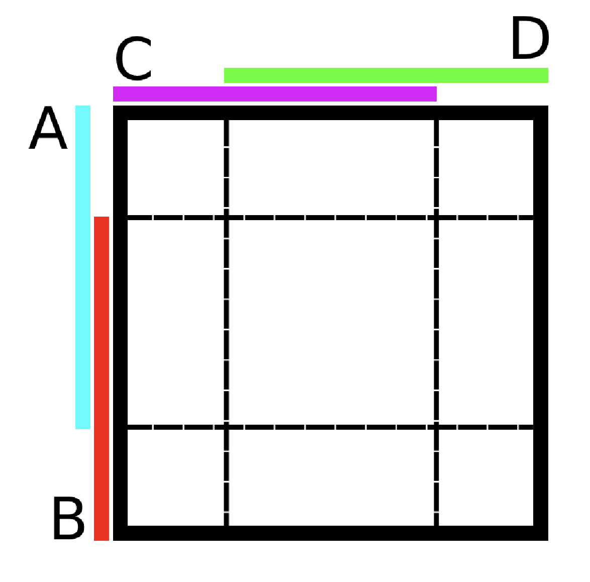

# Set Theory for Topology

The proofs follow after the results. Remember "iff" is an abbreviation "if and only if." Unless stated otherwise, all sets are subsets of $X$ which is the ambient space.

## Results

* [1] $(A \times C) \cap (B \times D) = (A \cap B) \times (C \cap D)$.
* [2] $A \subseteq B$ iff $X-B \subseteq X-A$.
* [3] $A - B = A \cap B^c$.
* [4] $f(f^{-1}(B)) \subseteq B$; there is equality iff $f$ is surjective.
* [5] $A \subseteq f^{-1}(f(A))$; there is equality iff $f$ is injective.
* [6] $A \subseteq B$ implies $f(A) \subseteq f(B)$.
* [7] $U \subseteq V$ implies $g^{-1}(U) \subseteq g^{-1}(V)$.
* [8] $g^{-1}(U \cap V) = g^{-1}(U) \cap g^{-1}(V)$.
* [9] $g^{-1}(U\cup V)=g^{-1}(U)\cup g^{-1}(V)$.
* [10] The composition of injective functions is injective.
* [11] The composition of surjective functions is surjective.

## Proofs

* [1] The above picture should make it visibly clear that $(A \times C) \cap (B \times D) = (A \cap B) \times (C \cap D)$. To prove this rigorously, let $(x,y) \in (A \times C) \cap (B \times D)$, meaning $(x,y) \in A\times C$ and $(x,y) \in B \times D$, thus $x\in A$ and $x\in B$ and $y \in C$ and $y\in D$, therefore $x\in A\cap B$ and $y\in C\cap D$ so $(x,y) \in (A\cap B)\times (C\cap D)$ which proves $(A\times C)\cap(B\times D)\subseteq (A\cap B)\times (C\cap D)$; let $(x,y)\in(A\cap B)\times(C\cap D)$, meaning $x\in A$, $y\in C$, $x\in B$, and $y\in D$ which means $(x,y)\in(A\times C)$ and $(x,y)\in(B\times D)$, therefore $(x,y)\in(A\times C)\cap(B\times D)$ which proves $(A\cap B)\times(C\cap D)\subseteq (A\cap B)\times(C\cap D)$. Therefore these sets are equal.
* [2] If $x\in A\subseteq B$, then $x\in B$, therefore $x\notin B$ implies $x\notin A$ which proves the forward implication. If $x\in X-B\subseteq X-A$, then $x\notin X-A$ implies $x\notin X-B$ which means $x\in B$, proving the reverse implication.
* [3] If $x\in A - B$, then $x\in A$ and $x\not\in B$, therefore $x\in B^c$ and $x\in A\cap B^c$. If $x\in A\cap B^c$, then $x\in A$ but $x\not\in B$, therefore $x\in A-B$.
* [4] If $x\in f(f^{-1}(B))$, then $f^{-1}(x)\in f^{-1}(B)$ because $f$ maps $x$ to $f(f^{-1}(B))$, and $f^{-1}(x)\in f^{-1}(B)$ means $x\in B$ because $f$ maps $x$ to $B$, therefore $f(f^{-1}(B))\subseteq B$. If $f$ is surjective, then each $y\in B$ has an $x\in X$ such that $f(x) = y$. Let $y \in B$ and let $f(x) = y$. Then $x\in f^{-1}(y)$, therefore $f(x) = y\in f(f^{-1}(B))$, proving $B\subseteq f(f^{-1}(B))$; consider $f(x):=\sin(x)$ which is not surjective, and $f(f^{-1}((-\infty,\infty)))=f((-\infty,\infty))=[-1,1]$.
* [5] If $x \in A$, then $f(x)\in f(A)$, therefore $x \in f^{-1}(f(A))$ because $f$ maps $x$ to $f(A)$, proving $A\subseteq f^{-1}(f(A))$. If $f$ is injective, then for all $x \in A$, no other points in $X$ (recall $A\subseteq X$) map to $f(x)$, therefore $f^{-1}(f(x))$ is the singleton $x$ for all $x\in A$, thus $f^{-1}(f(A)) = A$ because $f^{-1} \circ f$ is the identity map; consider $f(x):=x^2$ which is not injective, and $f^{-1}(f([0,1]))=f^{-1}([0,1])=[-1,1]$.
* [6] If $x\in f(A)$, then $\exists y\in A$ such that $f(y) = x$, thus $y\in B$ and $f(y) = x \in f(B)$.
* [7] If $x\in g^{-1}(U)$, then $g(x)\in U\subseteq V$, therefore $x\in g^{-1}(V)$.
* [8] If $x\in g^{-1}(U \cap V)$, then $g(x)\in U\cap V$, thus $g(x)\in U$ and $g(x)\in V$, therefore $x\in g^{-1}(U)$ and $x\in g^{-1}(V)$ so $x\in g^{-1}(U)\cap g^{-1}(V)$. If $x\in g^{-1}(U)\cap g^{-1}(V)$, then $x\in g^{-1}(U)$ so $g(x)\in U$ and $x\in g^{-1}(V)$ so $g(x)\in V$, thus $g(x)\in U\cap V$ and $x\in g^{-1}(U\cap V)$.
* [9] If $x\in g^{-1}(U\cup V)$, then $g(x)\in U\cup V$, so $g(x)\in U$ implies $x\in g^{-1}(U)\subseteq g^{-1}(U)\cup g^{-1}(V)$, and $g(x)\not\in U$ means $g(x)\in V$ so $x\in g^{-1}(V)\subseteq g^{-1}(U) \cup g^{-1}(V)$. If $x\in g^{-1}(U)\cup g^{-1}(V)$, then either $x\in g^{-1}(U)\subseteq g^{-1}(U\cup V)$ or $x\not\in g^{-1}(U)$ so $x\in g^{-1}(V)\subseteq g^{-1}(U\cup V)$.
* [10] Let $f:A\rightarrow B$ and $g:B\rightarrow C$ be injective. If $(g\circ f)(x)=(g\circ f)(y)$, the injectivity of $g$ means $f(x)=f(y)$, and the injectivity of $f$ means $x=y$, therefore $(g\circ f)(x)=(g\circ f)(y)$ implies $x=y$ so $g\circ f$ is injective.
* [11] Let $f:A\rightarrow B$ and $g:B\rightarrow C$ be surjective. If $z\in C$, $\exists y \in B$ such that $g(y) = z$ by the surjectivity of $g$, and $\exists x\in A$ such that $f(x) = y$ by the surjectivity of $f$, therefore $(g\circ f)(x) = z$. Since $z$ was arbitrary in $C$, $(g\circ f)$ is surjective.

The converse of [10] and [11] are not guaranteed. If $A$ is the singleton $0$, $B$ is $[0,1]$, and $C$ is the singleton $0$. If $f$ is the identity map and $g$ maps everything to 0, then $g\circ f$ is bijective even though $f$ is not surjective and $g$ is not injective.
