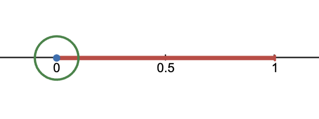

# Concepts & Proofs
**Recall:** in a topological space $(X,$**T**$)$, a set $C$ is closed when $X-C$ is open. Additionally, $U$ is open when $X-U$ is closed.

**Recall:** some sets are neither open nor closed, an example being &#8474; in the standard topology on &#8477;.
* **Just because $S$ is not open does not mean $S$ is closed! Just because $S$ is not closed does not mean $S$ is open!**

The meaning of a closed set is directly defined by the meaning of an open set, so it is very important to know how to prove that sets are open first. Very often, this is sufficient for proving that a set is closed.

## ⍟ Complements ⍟

Consider $[0,1]$ in the standard topology on the real line. The complement of $[0,1]$ is $(-\infty,0)\cup(1,\infty)$, and this set is open: for $p\in(-\infty,0)\cup(1,\infty)$, the open interval $(\min(p,2p),\max(p,2p))$ satisfies $p\in(\min(p,2p),\max(p,2p))\subseteq(-\infty,0)\cup(0,\infty)$, therefore $(-\infty,0)\cup(1,\infty)$ is open and its complement $[0,1]$ is closed.

## ⍟ Limit Points ⍟

The formal definition of a limit point $x$ of $A$ is $\forall U$ open with $x\in U$, $(U-\{x\})\cap A\ne \varnothing$, meaning that every open neighborhood around a point intersects the set $A$ at a *distinct point*. This is written as $x\in A&#2036;$.

Consider $(0,1)$. Neither $0$ nor $1$ are points in this set, however they are limit points because $0\in(a,b)$ and $(a,b)-\{0\}$ always intersects $(0,1)$ at $(0,\min\{b,1\})$, and $1\in(c,d)$ always intersects at $(\max\{0,a\},1)$. The picture below is an illustration of open sets around $0$ always intersecting the interval $(0,1)$, though it should not be taken literally because open sets in &#8477; look like straight lines, not circles.

## ⍟ (Lemma 2): a set $C$ is closed in $X$ if only if it contains all of its limit points, or $C&#2036; \subseteq C$. ⍟

$\Rightarrow$ If $C$ is closed, then $X-C$ is open by definition. Therefore for every point $p\in X-C$, $\exists U$ open in $X$ such that $p\in U\subseteq X-C$. $U\subseteq X-C$ implies $U\cap C=\varnothing$, therefore $p\not\in C&#2036;$ since $U-\{p\}\subseteq U$ which does not intersect $C$. By $C&#2036;\cap (X-C)=\varnothing$, $C&#2036;\subseteq C$. &#x2611;

$\Leftarrow$ Let $C&#2036;\subseteq C$. Then $X-C\subseteq X-C&#2036;$ by set theory. Thus for any $p\in X-C$, $p\in X-C&#2036;$ which implies $\exists U$ open in $X$ such that $p\in U$ and $U-\{p\}\cap C\subseteq U\cap C=\varnothing$ (for otherwise, $p$ would be a limit point, i.e. $p\in C&#2036;$). $U\cap C=\varnothing$ means $U\subseteq X-C$, thus $p\in U\subseteq X-C$. Therefore $X-C$ is open, thus $C$ is closed. &#x2611;

## ⍟ Closures ⍟

The closure of a set $A$ in $X$, written as $\overline A$, is the intersection of all closed supersets of $A$. The closure is also defined as $\overline A = A\cup A&#2036;$. These definitions are equivalent as is proven below.

$\Rightarrow$ Let $p$ be a point in the intersection of all closed supersets of $A$, thus for every closed set $C \supseteq A$, $p\in C$. Either $p\in A$, which trivially means $p\in A\cup A&#2036;$, or $p\not\in A$. If it is the case that $p\not\in A$ and $p\not\in A&#2036;$, then $\exists U$ open in $X$ such that $p\in U$ such that $(U-\{p\})\cap A\subseteq U\cap A=\varnothing$, meaning $p\in U\subseteq X-A$. Since $U$ is open, $X-U$ is closed and $A\subseteq X-U$, meaning there exists a closed set which does not contain $p$ since $p\in U$, contradicting $p$ being a point in the intersection of all closed supersets of $A$. Therefore either $p\in A$, or $p\not\in A$ but $p\in A&#2036;$. Therefore $p\in A\cap A&#2036;$.  &#x2611;

$\Leftarrow$ Let $p\in A\cap A&#2036;$. Consider any $C\subseteq A$, and recall that $p\in A$ implies $p\in C$. Now let $p\not\in A, p\in A&#2036;$ and assume by way of contradiction that $p\not\in C$. That would mean $\exists U$ open such that $x\in U\subseteq X-C\subseteq X-A$, meaning $U\cap A=\varnothing$. This contradicts $p\in A&#2036;$, therefore $p\in C$. Thus, whether $p\in A$ or $p\not\in A, p\in A&#2036;$ (i.e. $p\in A\cup A&#2036;$), $p$ is in the intersection of all closed supersets of $A$. &#x2611;

## ⍟ (Lemma 3): $p \in \overline A$ if and only if $\forall U$ open such that $p\in U$, $U \cap A \ne \varnothing$. ⍟

$\Rightarrow$ Assume that there exists an open $U$ such that $p\in U$ and $U\cap A = \varnothing$. Then $A\subseteq X-U$ where $X-U$ is closed, meaning $\overline{A}\subseteq X-U$ since $X-U$ is included in the intersection of all closed supersets of $A$. Therefore $p \in U$ implies $p\not\in X-U$ and thus $p\not\in \overline{A}$. The contrapositive of this result is that $p\in \overline{A}$ implies that $\forall U$ open such that $p\in U$ and $U\cap A\ne\varnothing$. &#x2611;

$\Leftarrow$ Assume that $p\not\in\overline{A}$. Then there exists a closed set $C \supseteq A$ such that $p\not\in C$ (for otherwise, $p$ would be in the intersection of all closed supersets of $A$ which is $\overline{A}$). Then $p\in X-C$ which is an open set, thus there exists an open set $U$ such that $p\in U\subseteq X-C$. Therefore $U\cap C=\varnothing$, meaning that $U\cap A\subseteq U\cap C=\varnothing$. The contrapositive of this result is that if all open sets containing $p$ intersect $A$, then $p\in\overline A.$ &#x2611;

* _Alternative Proof:_ $p\not\in\overline{A}$ means $p\not\in A$ and $p\not\in A&#2036;$, which implies that there is an open set $U$ such that $p\in U$ and $U\cap A\ne\varnothing$ since $p$ is not a limit point of $A$. &#x2611;

This result is so important that it deserves its own section. Every time you are asked if a point is in the closure or not, always consider open neighborhoods around said point to see whether it intersects the set or not. If all open neighborhoods intersect the set, the point is in the closure; if there is just one counterexample, the point is not in the closure.

## ⍟ Definition ⍟

Recall that arbitrary unions of open sets are open. This leads to arbitrary intersections of closed sets being closed. Similarly, finite intersections of open sets are open, therefore finite unions of closed sets are closed. As a counterexample to the relation holding in other arbitrary cases, the infinite intersection $\bigcap_{n\in\mathbb{N}} (-1/n,1/n)=\{0\}$ which is not open, and the infinite union $\bigcup_{n\in\mathbb{N}}[1/n,3-1/n]=(0,3)$ which is not closed. Additionally, if $S = \overline S$, or if $\overline S \subseteq S$, then $S$ is closed since the arbitrary intersection of closed sets is closed. If $T_1$ is finer than $T_A$, then if $S$ is closed in $T_A$, then $S$ is closed in $T_1$ (because $X-S$ being open in $T_A$ implies that $X-S$ is open in $T_1$).

## ⍟ Note on Topological Continuity ⍟

As one final note, if a function $f\colon X\rightarrow Y$ is topologically continuous, then $f^{-1}(C)$ is closed in $X$ for all $C$ closed in $Y$. This is _not_ the definition of topological continuity, but it follows from it: let $p$ be a point in the closure of $f^{-1}(C)$ in $X$, and let $V$ be an open neighborhood around $f(p)$. Then $p\in f^{-1}(V)$ which is open by topological continuity. By (Lemma 3) from $p$ being in the closure of $f^{-1}(C)$, the intersection $f^{-1}(V)\cap f^{-1}(C)\ne\varnothing$. Let $y\in f^{-1}(V)\cap f^{-1}(C)$. Then $f(y)\in V\cap C$, therefore $f(V)$ intersects $C$ which means $f(p)\in \overline{C}=C$ (because $C$ is closed), thus $p\in f^{-1}(C)$. Therefore the closure of $f^{-1}(C)$ is equal to $f^{-1}(C)$ which means that $f^{-1}(C)$ is closed whenever $C$ is closed in $Y$. &#x2611;
